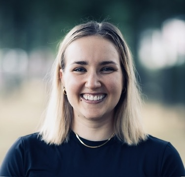

Hey there!

Nice that you found your way to my personal website. 
I'm Theresa and below you can find what I am doing and am passionate about.

::: {.panel-tabset}
## Methodology and Statistics
Hey, I'm Theresa and I currently enjoy to study the master's program M.Sc. Methodology and Statistics at Utrecht University.

{width=50% fig-align="center" fig-alt="Me"}

## Sport Science
Hey, I'm Theresa and in my Bachelor’s in Sports and Performance I gained varying scientific knowledge ranging from training and performance to physiology and health.

{width=50% fig-align="center" fig-alt="Me participating in a study"}

## Ice Skating
Hey, I'm Theresa and I regularly go ice skating and aim to make it to the Olympics in 2030 ;-). 

{width=50% fig-align="center" fig-alt="Me ice skating"}
:::

